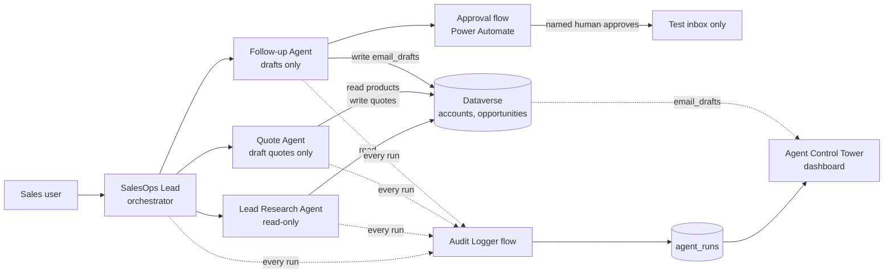

# SalesOps Squad + Agent Control Tower (demo)

A multi-agent sales assistant built in **Microsoft Copilot Studio**: one orchestrator and three specialist agents. It comes with a small **governance and cost dashboard** built in code.

> **Mock data only.** Every company, person and deal is fictional (Contoso, Fabrikam, ...).
> **Cost, token, risk and latency figures are simulated estimates.** They are not Microsoft billing and not Agent 365 output.
> This is a portfolio project. It is not affiliated with or endorsed by Microsoft.

**Live dashboard:** https://shaikh-saab.github.io/salesops-squad/


*Scan to open the live dashboard on your phone.*

---

## The problem

Before a sales call, a rep jumps between the CRM, the price list, the discount policy and their inbox. SalesOps Squad lets them ask once:

> "Prep me for the Contoso call, quote 50 licences of SKU-12 at the standard discount, and draft a follow-up."

The orchestrator splits the request across three specialists. A human approves anything customer-facing. Every step is logged and shown on the dashboard.

## Architecture



| Agent | Use when | Never |
| --- | --- | --- |
| **SalesOps Lead** (orchestrator) | Any sales request about an account | Sends email; answers HR or IT questions |
| **Lead Research Agent** | Account health, last contact, open deals, risks | Writes to tables; prices; emails |
| **Quote Agent** | Prices, quantities, discounts within policy | Approves quotes; goes above `max_discount_pct` |
| **Follow-up Agent** | Drafts follow-up emails, saved as pending | Sends; skips approval |

**Why multi-agent?** Each task needs different data, permissions and approval rules. Splitting them keeps each agent's access small and makes each one testable on its own.

Paste-ready agent text is in [`docs/agents/`](docs/agents/). The flows are described in [`flows/`](flows/).

## What's in the repo

| Path | Contents |
| --- | --- |
| [`docs/agents/`](docs/agents/) | Description and instructions for each agent, ready to paste into Copilot Studio |
| [`docs/pricing-policy.md`](docs/pricing-policy.md) | Knowledge file for the Quote Agent |
| [`docs/test-prompts.md`](docs/test-prompts.md) | 30 test prompts across 8 categories, with expected results |
| [`docs/scoring.csv`](docs/scoring.csv) | Scoring sheet (4 checks per prompt, first run and final run) |
| [`docs/case-study.md`](docs/case-study.md) | One-page case study |
| [`seed/`](seed/) | Mock-data generator (Python + Faker) and generated CSVs |
| [`dashboard/`](dashboard/) | Agent Control Tower (demo): Vite + Chart.js |
| [`flows/`](flows/) | Audit Logger and approval flow descriptions |

---

## How to use it

You can use it in three ways:

1. **Just look:** open the live link or scan the QR code above. Nothing to install.
2. **Run it on your computer:** follow the steps below. Works on Windows and macOS.
3. **Open it on your phone from your computer:** run it locally, then scan the QR code printed in the terminal (same Wi-Fi).

### 1. Install the prerequisites (once)

| Tool | Windows | macOS |
| --- | --- | --- |
| **Git** | https://git-scm.com/download/win | `xcode-select --install` (or https://git-scm.com/download/mac) |
| **Node.js 20 or 22 LTS** | https://nodejs.org (LTS installer) | https://nodejs.org (LTS installer) or `brew install node` |
| **Python 3.9+** (only to regenerate data) | https://www.python.org/downloads/ (tick **"Add python.exe to PATH"**) | Already installed as `python3`, or `brew install python` |

To check them, open **PowerShell** (Windows) or **Terminal** (macOS) and run:
```
git --version
node --version
python --version      # Windows
python3 --version     # macOS
```

### 2. Get the code

Same on both systems:
```
git clone https://github.com/Shaikh-Saab/salesops-squad.git
cd salesops-squad
```

### 3. Create your local settings file (optional)

The dashboard works without it, using the bundled demo CSVs.

**Windows (PowerShell)**
```powershell
Copy-Item .env.example .env
```
**macOS (Terminal)**
```bash
cp .env.example .env
```
`.env` is git-ignored. Never commit it. Anything starting with `VITE_` is built into the web page, so put only public values there.

### 4. Run the dashboard locally

Same on both systems:
```
cd dashboard
npm install
npm run dev
```
Open **http://localhost:5173** in your browser. Press `Ctrl + C` in the terminal to stop it.

### 5. Open it on your phone (QR code)

When `npm run dev` starts, the terminal prints:
```
➜  Local:   http://localhost:5173/
➜  Network: http://192.168.x.x:5173/

Scan to open on your phone (same Wi-Fi): http://192.168.x.x:5173/
█▀▀▀▀▀█ ...   <- QR code
```
Scan the QR code with your phone camera. Your phone must be on the **same Wi-Fi** as your computer.

- **Windows:** the first time, Windows Firewall asks whether Node.js can use the network. Choose **Allow** on **Private networks**.
- **macOS:** if prompted "Do you want the application node to accept incoming network connections?", click **Allow**.
- No QR code printed? You're probably not on Wi-Fi or Ethernet. Use the live link instead.

The dashboard also shows a QR code of its own address at the bottom of the page, so you can pass it to someone next to you.

### 6. Regenerate the mock data (optional)

**Windows (PowerShell)**
```powershell
cd seed
py -m venv .venv
.venv\Scripts\Activate.ps1
pip install -r requirements.txt
python generate_data.py
```
If PowerShell says running scripts is disabled, run `Set-ExecutionPolicy -Scope CurrentUser RemoteSigned` once, then try again.

**macOS (Terminal)**
```bash
cd seed
python3 -m venv .venv
source .venv/bin/activate
pip install -r requirements.txt
python generate_data.py
```
This rewrites `seed/output/*.csv` (to import into Dataverse or Supabase) and `dashboard/public/data/*.csv` (the dashboard's demo rows). The output is identical every time (fixed seed). Import steps are in [`seed/README.md`](seed/README.md).

### 7. Publish your own live copy (optional)

Fork the repo, then from `dashboard/` (same on both systems):
```
npm run deploy
```
This builds the site and pushes it to a `gh-pages` branch. Then, once, go to **GitHub → your repo → Settings → Pages**, set **Source: Deploy from a branch**, and choose **Branch: gh-pages / (root)**. Your site appears at `https://<your-username>.github.io/salesops-squad/` within a minute or two.

If you renamed the repo, set the base path first:
- Windows: `$env:VITE_BASE="/<repo-name>/"; npm run deploy`
- macOS: `VITE_BASE=/<repo-name>/ npm run deploy`

Then make a QR code for your live link:
```
npm run qr:live -- https://<your-username>.github.io/<repo-name>/
```
It is saved to `docs/qr-live.png`.

### 8. Point the dashboard at real (test) data

All data access goes through [`dashboard/src/config.js`](dashboard/src/config.js) and [`dashboard/src/data.js`](dashboard/src/data.js). Switching source is a settings change:

| `VITE_DATA_SOURCE` | What to do |
| --- | --- |
| `csv` (default) | Export `agent_runs` and `email_drafts` from Dataverse as CSV into `dashboard/public/data/` |
| `supabase` | Set `VITE_SUPABASE_URL` and `VITE_SUPABASE_ANON_KEY` in `.env`. Use the anon key with read-only RLS policies, never the service_role key |
| `dataverse` | Not called directly from the browser (it would need OAuth and would expose the tenant). Use the CSV export |

### 9. Build the agents in Copilot Studio

1. Create a Copilot Studio trial or developer environment with Dataverse.
2. Import the CSVs from `seed/output/` as tables (see [`seed/README.md`](seed/README.md)).
3. Create the three specialists, then the orchestrator, pasting from [`docs/agents/`](docs/agents/). Turn **generative orchestration** on and add the specialists as connected agents.
4. Build the two flows described in [`flows/`](flows/).
5. Run the 30 prompts in [`docs/test-prompts.md`](docs/test-prompts.md) and score them in [`docs/scoring.csv`](docs/scoring.csv).

---

## The dashboard

| Panel | Shows |
| --- | --- |
| Summary tiles | Total runs, success rate, average latency (estimate), total estimated cost (simulated) |
| Runs per agent | Runs by agent, split by outcome (success, escalated, failed) |
| Cost per successful run | Estimated USD per agent |
| Approval queue | Drafts waiting for a human. Buttons here are a local demo only; real approvals happen in Power Automate |
| Risk flags | Runs that touched customer data without approval, or ended escalated or failed |
| Recent runs | Last 20 runs with request, agent, tools, outcome, cost and risk |

**Risk score.** Start at 0. Add 2 if the run touched customer data. Add 3 if a customer-facing action has no human approval. Add 1 if the run failed or was escalated. Levels: low 0–1, medium 2–3, high 4+.

**Cost model (assumption).** `(tokens_in × $0.003 + tokens_out × $0.015) / 1,000`. Copilot Studio doesn't expose per-run token usage to flows, so tokens are estimated from text length (about 4 characters per token).

## Results

The 30-prompt test run has not happened yet. Scores will be filled in from [`docs/scoring.csv`](docs/scoring.csv).

| Metric | First run | Final run |
| --- | --- | --- |
| Routing accuracy | – / 30 | – / 30 |
| Fact accuracy | – / 30 | – / 30 |
| Policy compliance | – / 30 | – / 30 |
| Audit coverage | – / 30 | – / 30 |
| Avg est. cost per request (simulated) | – | – |

## GA vs preview vs mocked

Status was checked against public docs around Microsoft Ignite (17 Nov 2026). Verify before relying on it.

| Capability | Status in this project |
| --- | --- |
| Copilot Studio agents, generative orchestration, connected Copilot Studio agents | Used. Generally available |
| Power Automate flows and Approvals connector | Used. Generally available |
| Dataverse tables | Used. Generally available |
| MCP / A2A integration | Not used (stretch goal). Generally available |
| Connecting Foundry, Fabric Data or M365 Agents SDK agents | Not used. Public preview at the time of research |
| Agent 365 (registry, activity insights, risk, cost management) | **Not used. Mocked** by this repo's own `agent_runs` table and dashboard. Many features are preview, Frontier or licensed |
| Per-run token usage and cost | **Simulated** (estimated from text length and assumed prices) |

## Safety and data rules

- Mock data only. No real customer records, emails or tenant IDs anywhere in the repo, screenshots or video.
- No secrets in code. Settings live in a git-ignored `.env`; `.env.example` holds placeholders.
- No real email sending. Emails go only to the author's own test inbox, after a named human approves.

## Author

Built by Muhammad Mudassir as a final-year CS (AI) portfolio project, November 2026.
